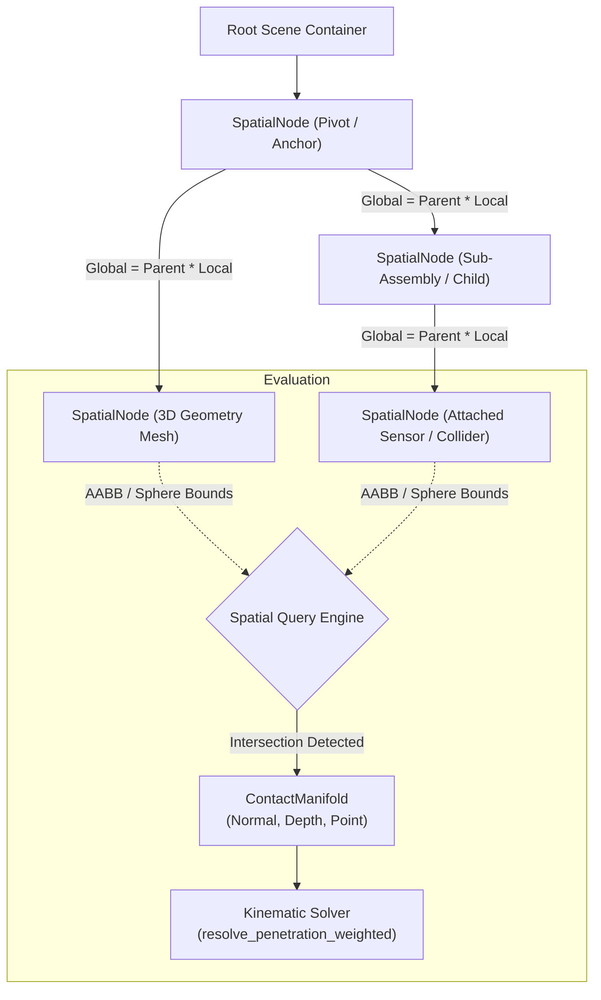
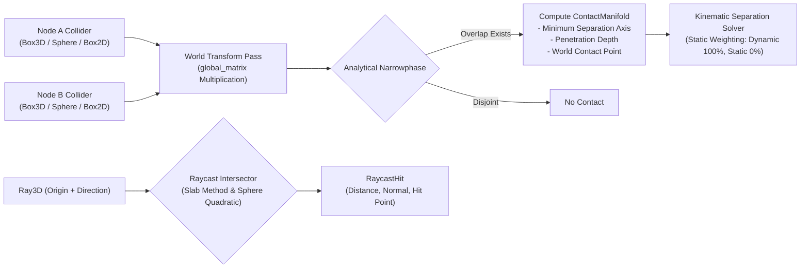

# Oxide Engine

[](https://www.rust-lang.org/)
[](https://www.khronos.org/opengl/)
[]()
[]()
[](LICENSE-MIT)

**Oxide** is a lightweight, high-performance, modular 2D/3D multimedia and simulation runtime engine written in Rust and OpenGL 3.3 Core Profile. Designed for engineering simulations, spatial visualization, interactive workbenches, and cross-language runtime embeddings.

---

## Architecture Overview

Oxide combines the memory safety and speed of native Rust with a universal C-ABI runtime layer, enabling applications and external scripts in Python, C, C++, C#, or Zig to drive scenes, render passes, and physics without modifying or recompiling the engine.

```mermaid
graph LR
    subgraph Language Ecosystem
        RustApp[Rust Applications]
        PythonApp[Python Workspaces]
        CppApp[C / C++ Programs]
        CSharpApp[C# / Zig Runtimes]
    end

    subgraph Oxide Runtime Core
        Facade["Unified Engine Facade<br/>(oxide::prelude & C-ABI)"]
        SceneGraph["Hierarchical Scene Graph<br/>(Parent-Child Transform Tree)"]
        CollisionEngine["Spatial Query & Collision Engine<br/>(AABB, Sphere, Raycasting)"]
        TextEngine["Typography Engine<br/>(Fontdue + 1024x1024 Glyph Atlas)"]
        RenderBackend["OpenGL 3.3 Core Render Pipeline<br/>(3D Lit + 2D Orthographic)"]
    end

    Language Ecosystem --> Facade
    Facade --> SceneGraph
    Facade --> CollisionEngine
    Facade --> TextEngine
    SceneGraph --> RenderBackend
    TextEngine --> RenderBackend
    CollisionEngine --> SceneGraph
```

### Core Design Foundations

1. **Zero Game-Specific Jargon:** Built for serious simulation and visualization. Uses strictly neutral systems terminology: `Runtime`, `App`, `Context`, `SpatialNode`, `NodeBehavior`, `Surface2D`, `Mesh3D`, `Collider`, and `ContactManifold`.
2. **Two-Tiered Coordinate Model:**
   - **3D World:** Right-handed system ($Y$-up, $-Z$ forward) with perspective projection, directional Lambertian/Blinn-Phong lighting, emissive materials, and depth testing.
   - **2D Overlay:** Screen pixel space ($(0, 0)$ at top-left, $X$ right, $Y$ down) with orthographic projection, alpha blending, and resolution independence.
3. **Dual Linking Architecture:** Compiles simultaneously as a static Rust crate (`rlib`) and an unmanaged dynamic shared library (`cdylib`: `oxide.dll` / `liboxide.so`) exposing a standard ANSI C99 header (`include/oxide.h`).
4. **Behavior Component System:** External scripts can attach custom components implementing the `NodeBehavior` trait (`.with_behavior(...)`) to any `SpatialNode` to drive autonomous logic without altering internal engine code.

---

## System Pipelines & Execution Cycles

### 1. Frame Execution Cycle

```mermaid
sequenceDiagram
    autonumber
    actor OS as OS / Window Event Loop
    participant Core as Oxide Core Runner
    participant User as AppHandler (User Logic)
    participant Scene as Scene Graph
    participant GPU as OpenGL 3.3 Hardware

    OS->>Core: Window RedrawRequested Event
    Core->>Core: Update Time & DeltaTime Clamping
    Core->>User: on_update(ctx, dt)
    User->>Scene: Transform Node Rotations / Physics Step
    User->>Scene: Query check_intersection() & resolve_penetration()
    Core->>User: on_render(ctx)
    User->>GPU: ctx.clear(color)
    User->>Scene: scene.render(ctx)
    
    rect rgb(20, 24, 34)
        Note over Scene,GPU: Phase 1: 3D Lighting & Geometry Pass
        Scene->>GPU: Bind Pipeline3D (View & Perspective Projections)
        Scene->>GPU: Draw 3D Meshes (Normal Matrix + Light Direction + Emissive)
    end

    rect rgb(24, 30, 42)
        Note over Scene,GPU: Phase 2: 2D Screen Overlay Pass
        Scene->>GPU: Bind Pipeline2D (Screen Orthographic Projection)
        Scene->>GPU: Draw Planar Surfaces (Alpha Blending Enabled)
    end

    rect rgb(30, 36, 52)
        Note over Scene,GPU: Phase 3: Batched Glyph Typography Pass
        Scene->>GPU: Bind PipelineText (1024x1024 Texture Atlas)
        Scene->>GPU: Draw Dynamic Text Batches (Single Draw Call)
    end

    Core->>OS: Swap Framebuffers (VSync)
```



---

### 2. Hierarchical Scene Graph & Transform Propagation



---

### 3. Collision Detection & Spatial Query Pipeline



---

## Technical Specifications

| Metric / Feature | Specification | Architectural Detail |
| :--- | :--- | :--- |
| **Graphics API** | OpenGL 3.3 Core Profile | Zero-overhead safe abstraction layer via `glow` |
| **Window & Events** | `winit 0.29` + `glutin 0.31` | Hardware accelerated surface, VSync, DPI-aware |
| **Vector Mathematics** | `glam` | SIMD-aligned vector, quaternion, and matrix math |
| **Scene Hierarchy** | Recursive Parent-Child Tree | Cascading TRS transforms with cached global matrices |
| **Lighting Model** | Blinn-Phong / Lambertian | Directional light vector + ambient floor + emissive colors |
| **2D / UI Layer** | Screen-Space Orthographic | Top-left origin in physical pixels, alpha blending |
| **Typography Engine** | `fontdue` Vector Rasterizer | Dynamic 1024x1024 atlas, Latin + Full Cyrillic support |
| **Asset Formats** | Wavefront `.obj` & Images | Built-in procedural primitives (Cube, Sphere, Plane) |
| **Cross-Language FFI** | Standard C-ABI (`oxide.h`) | Native bindings for Python (`ctypes`), C, C++, C#, Zig |

---

## Quickstart & Usage

### 1. Minimal Rust Application

Add Oxide to your `Cargo.toml`:

```toml
[dependencies]
oxide = { path = "../Oxide" }
```

Create an application handler:

```rust
use oxide::prelude::*;

struct SimulationApp;

impl AppHandler for SimulationApp {
    fn on_init(&mut self, ctx: &mut Context) {
        println!("Oxide initialized at {}x{}", ctx.width, ctx.height);
    }

    fn on_render(&mut self, ctx: &mut Context) {
        ctx.clear(Color::rgb(0.08, 0.10, 0.15));
    }
}

fn main() -> Result<(), OxideError> {
    App::build()
        .with_title("Oxide Runtime")
        .with_size(1280, 720)
        .run(SimulationApp)
}
```

Run the minimal window example:

```bash
cargo run --example minimal_window
```

---

### 2. Multi-Language Scripting via C-ABI

Compile the shared library:

```bash
cargo build --release
```

#### Python (`ctypes`):

```python
from bindings.python.oxide import OxideApp, OxideColor

app = OxideApp(title="Python Oxide Simulation", width=1280, height=720)

@app.on_render
def render(ctx):
    ctx.clear(OxideColor(0.05, 0.08, 0.14, 1.0))

app.run()
```

Run directly:

```bash
python examples/python_simulation.py
```

#### Native C / C++:

Include [`include/oxide.h`](include/oxide.h) and link against `oxide.dll` / `liboxide.so`:

```c
#include "oxide.h"

void on_render(OxideContext* ctx, void* user_data) {
    OxideColor bg = {0.05f, 0.08f, 0.14f, 1.0f};
    oxide_context_clear(ctx, bg);
}

int main(void) {
    OxideApp* app = oxide_app_create("C Application", 1280, 720);
    OxideCallbacks cb = {0};
    cb.on_render = on_render;
    return oxide_app_run(app, cb);
}
```

---

## Detailed Documentation

Comprehensive architectural and module-level guides are available in the [`docs/`](docs/) directory:

- 🇷🇺 **Russian Documentation:** [`docs/ru/index.md`](docs/ru/index.md)
  - [`core.md`](docs/ru/core.md) • [`spatial.md`](docs/ru/spatial.md) • [`renderer.md`](docs/ru/renderer.md) • [`collision.md`](docs/ru/collision.md) • [`text.md`](docs/ru/text.md) • [`assets.md`](docs/ru/assets.md) • [`ffi.md`](docs/ru/ffi.md)
- 🇬🇧 **English Documentation:** [`docs/en/index.md`](docs/en/index.md)
  - [`core.md`](docs/en/core.md) • [`spatial.md`](docs/en/spatial.md) • [`renderer.md`](docs/en/renderer.md) • [`collision.md`](docs/en/collision.md) • [`text.md`](docs/en/text.md) • [`assets.md`](docs/en/assets.md) • [`ffi.md`](docs/en/ffi.md)

---

## License

Dual-licensed under either of:

- Apache License, Version 2.0 ([`LICENSE-APACHE`](LICENSE-APACHE))
- MIT License ([`LICENSE-MIT`](LICENSE-MIT))

at your option.
