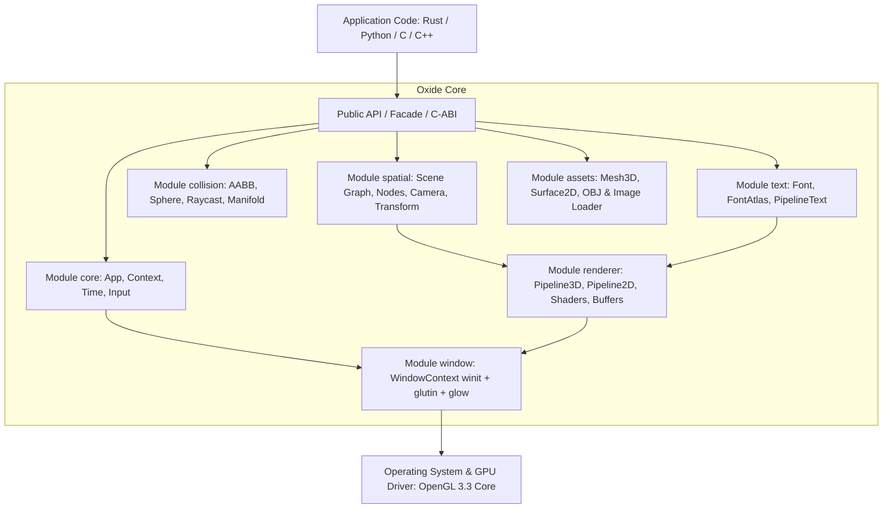

# Oxide Engine — Architectural Guide

> **Authors:** Nazaryan Artem (`nazaryannnn36@gmail.com`) & Google Gemini 3.8  
> **Core Stack:** Rust + OpenGL 3.3 Core Profile

---

## Overview

**Oxide** is a modular, high-performance multimedia and simulation runtime engine. Its architecture is engineered as the foundation for future interactive design environments (conceptually aligned with Godot's node and scene hierarchy, but strictly replacing game-specific jargon with systems engineering terminology).

The framework simultaneously supports native Rust development via the unified `oxide::prelude::*` facade, and any language with C-ABI compatibility (C, C++, Python, C#, Zig) via `oxide.dll` / `liboxide.so` and `include/oxide.h`.

---

## Architectural Stack

---

## Documentation Structure

Module documentation is organized as follows:

| Module | Description | Document |
| :--- | :--- | :--- |
| **`core`** | Application lifecycle, frame timing, input state, execution context, errors | [`docs/en/core.md`](file:///e:/PRJCT/Oxide/docs/en/core.md) |
| **`window`** | `winit 0.29` event loop, `glutin 0.31` OpenGL context creation, `glow` binding | [`docs/en/window.md`](file:///e:/PRJCT/Oxide/docs/en/window.md) |
| **`spatial`** | Hierarchical scene graph, TRS transforms, parent-child propagation, cameras | [`docs/en/spatial.md`](file:///e:/PRJCT/Oxide/docs/en/spatial.md) |
| **`renderer`** | 3D lit pipeline, 2D quad pipeline, GLSL shaders, GPU buffers, textures | [`docs/en/renderer.md`](file:///e:/PRJCT/Oxide/docs/en/renderer.md) |
| **`collision`** | Analytical collisions (Box 2D/3D, Sphere), Raycasting, penetration resolution | [`docs/en/collision.md`](file:///e:/PRJCT/Oxide/docs/en/collision.md) |
| **`text`** | TTF/OTF rasterization via `fontdue`, 1024x1024 atlas, Cyrillic typography | [`docs/en/text.md`](file:///e:/PRJCT/Oxide/docs/en/text.md) |
| **`assets`** | Procedural primitives (cube, sphere, plane), Wavefront OBJ and image loaders | [`docs/en/assets.md`](file:///e:/PRJCT/Oxide/docs/en/assets.md) |
| **`ffi`** | External C-ABI interface, `oxide.h` header, zero-dependency Python wrapper | [`docs/en/ffi.md`](file:///e:/PRJCT/Oxide/docs/en/ffi.md) |

---

## Core Engineering Principles

1. **Zero Game-Specific Jargon:**
   - `Game` -> `App`, `Runtime`.
   - `Actor` / `GameObject` -> `SpatialNode`, `Element`.
   - `Level` -> `Scene`, `Workspace`.
   - `Sprite` -> `Surface2D`, `PlanarMesh`, `TextureQuad`.
2. **Single-Import Facade:**
   - A single `use oxide::prelude::*;` imports everything needed to build, simulate, and render.
3. **Two-Tiered Coordinate Model:**
   - **3D World:** Right-handed system (Y-up, -Z forward), perspective camera, directional and ambient lighting.
   - **2D Overlay:** Screen pixel space (top-left origin `(0, 0)`, X-right, Y-down), orthographic camera, alpha blending.
4. **Cross-Platform and Multi-Language:**
   - Single Rust codebase builds both as an `rlib` and a `cdylib` without ABI fragmentation.
