# Oxide Architecture Guide

Oxide is a modular 2D/3D rendering, spatial hierarchy, and collision detection engine written in Rust with an OpenGL 4.5 Core Profile graphics backend. It provides decoupled subsystems for real-time graphics, transform hierarchies, geometric collision queries, and multi-language embedding via a C99 ABI.

---

## Frame Execution Pipeline

Each frame in Oxide follows a deterministic execution pipeline:

```mermaid
sequenceDiagram
    autonumber
    participant OS as OS Window Manager
    participant Window as window::WindowContext
    participant Core as core::App / Event Loop
    participant InputTime as InputState & Time
    participant Scene as spatial::Scene
    participant Collision as collision::Collider
    participant Renderer as renderer::Pipeline
    participant GPU as Graphics Processing Unit (GPU)

    OS->>Window: Input / Redraw Events (RedrawRequested)
    Window->>Core: WindowEvent
    Core->>InputTime: Update Time (compute dt) and InputState
    Core->>Scene: scene.update(ctx, dt)
    Scene->>Scene: update_transforms() (recalculate world matrices)
    Scene->>Collision: check_intersection() / resolve_penetration()
    Core->>Renderer: scene.render(ctx)
    rect rgb(20, 24, 34)
        Renderer->>GPU: Phase 1: 3D Pass (Pipeline3D, depth test, lighting)
    end
    rect rgb(24, 30, 42)
        Renderer->>GPU: Phase 2: 2D Pass (Pipeline2D, screen quads, blending)
    end
    rect rgb(28, 36, 50)
        Renderer->>GPU: Phase 3: Text Pass (PipelineText, glyph atlas)
    end
    Renderer->>Window: swap_buffers() (framebuffer swap)
    Window->>OS: Present rendered frame to display
```

### Frame Execution Stages:
1. **Window Event Polling:** The `window` subsystem receives resize, focus, and user input events from the operating system via `winit`.
2. **Timing and Input Updates:** `Time` calculates frame delta time $\Delta t$ (clamped to 0.1s to avoid latency spirals), while `InputState` tracks discrete state transitions for keyboard keys and mouse buttons.
3. **Scene Graph Traversal:** `Scene::update` traverses the hierarchy, recursively evaluating global transformation matrices ($M_{\text{global}} = M_{\text{parent}} \times M_{\text{local}}$), and invokes attached `NodeBehavior` logic.
4. **Geometric Collision Detection:** Intersections between node bounding volumes (`Collider`) are evaluated, generating contact manifolds (`ContactManifold`), followed by kinematic penetration resolution.
5. **Multi-Pass Rendering:**
   - **Phase 1 (3D Pass):** Binds `Pipeline3D`, enables depth testing (`GL_DEPTH_TEST`), uploads view and projection matrices, calculates directional lighting, and renders polygon geometry `Mesh3D`.
   - **Phase 2 (2D Pass):** Binds `Pipeline2D`, disables depth testing, enables alpha blending, applies screen-space orthographic projection, and renders planar quads `Surface2D`.
   - **Phase 3 (Text Pass):** Binds `PipelineText`, binds the texture atlas `FontAtlas`, and draws character batches `Text2D` in a single `glDrawElements` call.
6. **Buffer Swap:** `WindowContext::swap_buffers` swaps the front and back framebuffers with vertical synchronization enabled.

---

## Documentation Index

| Module | File | Subsystem Description |
| :--- | :--- | :--- |
| **`core`** | [`core.md`](core.md) | Application lifecycle (`App`), execution context (`Context`), timing (`Time`), input polling (`InputState`), typed errors (`OxideError`). |
| **`window`** | [`window.md`](window.md) | OS window initialization, OpenGL 4.5 Core context binding (`WindowContext`), viewport configuration. |
| **`renderer`** | [`renderer.md`](renderer.md) | Graphics pipelines (`Pipeline3D`, `Pipeline2D`), GLSL shader programs (`ShaderProgram`), GPU buffers (`VertexArray`, `VertexBuffer`, `IndexBuffer`), textures (`Texture2D`). |
| **`spatial`** | [`spatial.md`](spatial.md) | Hierarchical scene graph (`Scene`, `SpatialNode`), spatial transforms (`Transform`), perspective and orthographic camera models (`Camera`). |
| **`collision`** | [`collision.md`](collision.md) | Geometric collision detection (`Collider`: Box3D, Sphere, Box2D), contact manifolds (`ContactManifold`), raycasting (`Ray3D`, `RaycastHit`). |
| **`assets`** | [`assets.md`](assets.md) | RAM polygonal geometry (`Mesh3D`), 2D surfaces (`Surface2D`), procedural primitive generators, Wavefront OBJ and image loaders. |
| **`text`** | [`text.md`](text.md) | TrueType/OpenType font parsing (`Font`), 1024x1024 glyph atlas generation (`FontAtlas`), text elements (`Text2D`), text rendering pipeline (`PipelineText`). |
| **`math`** | [`math.md`](math.md) | Coordinate systems, angular units, vector, matrix, and quaternion re-exports from `glam`. |
| **`ffi`** | [`ffi.md`](ffi.md) | C ABI symbol export (`include/oxide.h`), manual Rust heap lifetime management, Python `ctypes` bindings (`bindings/python/oxide.py`). |

---

## Design Principles

1. **Decoupled Subsystem Architecture:** Core modules (`renderer`, `spatial`, `collision`, `text`, `assets`) can be used independently or integrated into a unified application runtime.
2. **Explicit RAM / VRAM Separation:** Host-side asset structures (`Mesh3D`, `Surface2D`, `Font`) are cleanly segregated from GPU VRAM resources (`VertexArray`, `VertexBuffer`, `Texture2D`), preventing hidden allocations.
3. **Single-Import Prelude Facade:** All common engine types, math structures, and loader functions are accessible via `use oxide::prelude::*;`.
4. **Cross-Platform C ABI:** The core library compiles simultaneously as a static Rust crate (`rlib`) and a shared dynamic library (`cdylib`), exposing a standard C99 interface.
