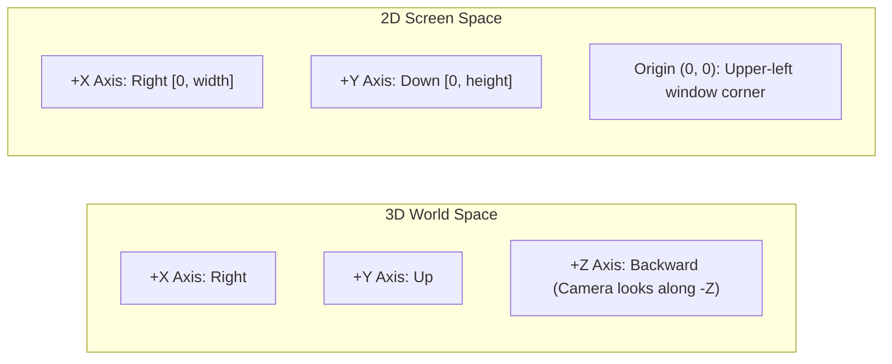

# Subsystem `math` — Linear Algebra and Geometric Calculations

The `math` module provides foundational linear algebra primitives, re-exporting SIMD-aligned vector, matrix, and quaternion types from `glam`, precision constants, and angular unit conversion functions.

Source code: [`src/math/`](../../src/math/)

---

## 1. Coordinate Systems

Oxide strictly separates 3D world space from 2D screen space:



### 1.1. 3D World Space (Right-Handed):
- Used by the scene graph (`spatial::Scene`), 3D polygon meshes (`Mesh3D`), bounding volumes (`Collider::Box3D`, `Collider::Sphere`), and rays (`Ray3D`).
- **Axes:** $+X$ points right, $+Y$ points up, $+Z$ points backward (perspective camera looks along $-Z$ by default).
- **View and Projection Matrices:** Generated using `Mat4::look_at_rh` and `Mat4::perspective_rh_gl`.

### 1.2. 2D Screen Space:
- Used by planar surfaces (`Surface2D`), screen typography (`Text2D`), and 2D bounding boxes (`Aabb2D`).
- **Axes:** The origin $(0, 0)$ is fixed at the **top-left corner** of the window. The $+X$ axis extends right $[0, \text{width}]$, and the $+Y$ axis extends downwards $[0, \text{height}]$.
- **Orthographic Matrix:** Constructed via `Mat4::orthographic_rh_gl(0.0, width, height, 0.0, -1.0, 1.0)`.

---

## 2. Re-Exported Types (`glam`)

The module re-exports core linear algebra primitives from `glam`:

| Type | Description | Size and Alignment |
| :--- | :--- | :--- |
| `Vec2` | 2D vector with `x, y: f32` components. | 8 bytes, 4-byte alignment |
| `Vec3` | 3D vector with `x, y, z: f32` components. | 12 bytes, 4-byte alignment |
| `Vec4` | 4D vector with `x, y, z, w: f32` components. | 16 bytes, 16-byte SIMD alignment |
| `Quat` | Unit orientation quaternion `x, y, z, w: f32`. | 16 bytes, 16-byte SIMD alignment |
| `Mat2` | $2 \times 2$ column-major matrix. | 16 bytes |
| `Mat3` | $3 \times 3$ column-major matrix. | 36 bytes |
| `Mat4` | $4 \times 4$ column-major affine transform matrix. | 64 bytes, 16-byte SIMD alignment |

Convenience constructor functions are also re-exported: `vec2(x, y)`, `vec3(x, y, z)`, `vec4(x, y, z, w)`.

---

## 3. Constants and Angular Units

```rust
pub const EPSILON: f32 = 1e-5;

#[inline]
pub fn deg_to_rad(deg: f32) -> f32;

#[inline]
pub fn rad_to_deg(rad: f32) -> f32;
```

### Units and Conventions:
- All internal angular function arguments (`rotate_x`, `rotate_y`, `rotate_z`, `fov_y_rad` in `Projection::Perspective`) expect angles in **radians**.
- Camera creation helpers (`Camera::perspective`) accept the vertical field-of-view in **degrees** for configuration clarity and convert to radians internally using `deg_to_rad`.
- `EPSILON = 1e-5` is employed in geometric contact comparisons, vector normalization, and division-by-zero guards.
