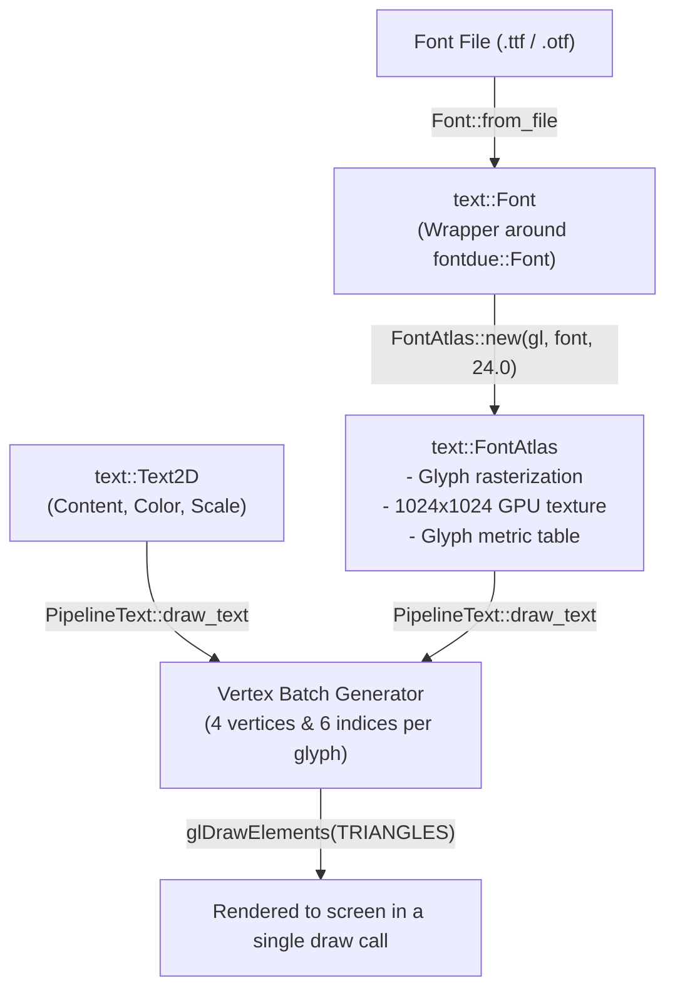

# Subsystem `text` — Typography, Glyph Atlas, and Text Rendering

The `text` module provides TrueType/OpenType vector font parsing, glyph rasterization into texture atlases, and batched 2D text rendering in OpenGL.

Source code: [`src/text/`](../../src/text/)

---

## 1. Text Rendering Pipeline

The Oxide text rendering pipeline executes across four sequential stages:



---

## 2. Font Loading (`Font`)

`Font` encapsulates the underlying `fontdue` font parser in an `Arc`:

```rust
// Load from file on disk
let font = Font::from_file("assets/fonts/DejaVuSans.ttf")?;

// Load from in-memory byte slice
let font = Font::from_bytes(FONT_BYTES)?;

// Locate default system or local font
let font = Font::default_font()?;
```

`Font::default_font()` checks the following candidate paths in order:
1. `assets/fonts/DejaVuSans.ttf`
2. `C:\Windows\Fonts\DejaVuSans.ttf`
3. `/usr/share/fonts/truetype/dejavu/DejaVuSans.ttf`
4. `C:\Windows\Fonts\segoeui.ttf`
5. `/System/Library/Fonts/Helvetica.ttc`

---

## 3. Glyph Texture Atlas (`FontAtlas`)

Calling `FontAtlas::new(gl, font, font_size)` executes the following:
1. Allocates a `1024x1024` RGBA8 pixel memory buffer.
2. Rasterizes the following character ranges:
   - **Printable ASCII:** `32..=126` (space, digits, Latin letters, punctuation).
   - **Extended Cyrillic:** `0x0400..=0x045F` (Cyrillic uppercase/lowercase letters, Ё/ё, and regional signs).
   - **Common Typography:** `№`, `«`, `»`, `—`, `–`, `°`, `±`, `•`, `…`, `’`, `”`, `“`.
3. Packs glyph bitmaps using a shelf packing algorithm with 1-pixel padding. Pixel coverage values are stored in the texture alpha channel.
4. Allocates the GPU VRAM texture via `Texture2D::new`.
5. Maps each character to a `Glyph` metrics structure:
   ```rust
   pub struct Glyph {
       pub uv_min: Vec2,
       pub uv_max: Vec2,
       pub size: Vec2,
       pub offset: Vec2,
       pub advance_x: f32,
   }
   ```

### Text Measurement:
```rust
let dimensions: Vec2 = atlas.measure_text("Measured text line\nSecond line");
```

---

## 4. Text Element Descriptor (`Text2D`)

```rust
pub struct Text2D {
    pub content: String,
    pub color: Color,
    pub scale: f32,
}
```

Constructors:
```rust
let text = Text2D::new("Oxide Simulation Engine")
    .with_color(Color::rgb(0.2, 0.8, 1.0))
    .with_scale(1.2);
```

---

## 5. Text Render Pipeline (`PipelineText`)

The text fragment shader samples the alpha mask from the atlas and modulates it by the text color:
$$\mathbf{C}_{\text{out}} = (\mathbf{C}_{\text{color}}.\text{rgb}, \mathbf{C}_{\text{color}}.\text{a} \cdot \alpha_{\text{atlas}})$$

### Batched Submission:
`draw_text` batches all characters in a string into local vertex and index buffers (4 vertices and 6 indices per character) and submits them in a single draw call:
```rust
pipeline_text.begin(ctx.gl, ctx.width as f32, ctx.height as f32);
pipeline_text.draw_text(
    ctx.gl,
    &atlas,
    "Batched typography rendering",
    Vec2::new(40.0, 50.0),
    Color::WHITE,
    1.0,
)?;
pipeline_text.end(ctx.gl);
```
