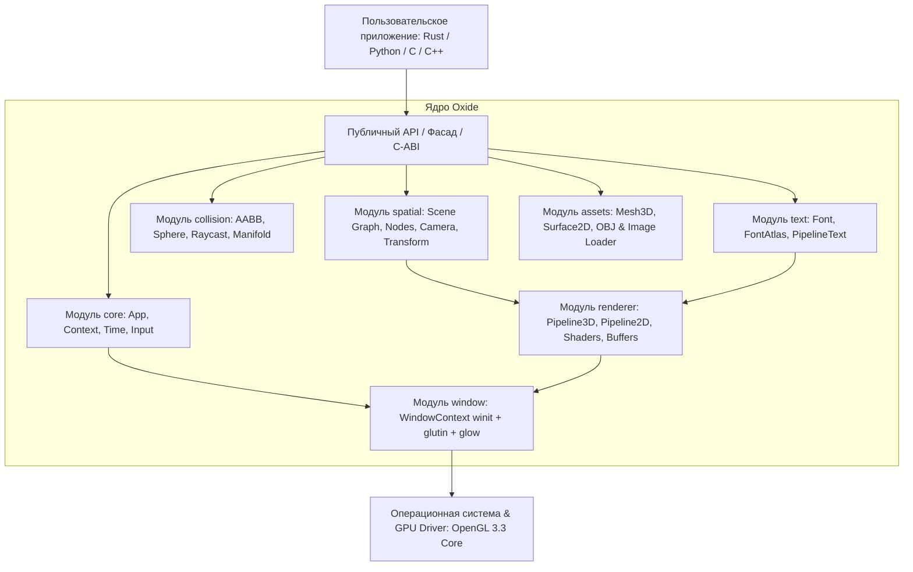

# Oxide Engine — Архитектурное руководство

> **Авторы:** Nazaryan Artem (`nazaryannnn36@gmail.com`) & Google Gemini 3.8  
> **Язык ядра:** Rust + OpenGL 3.3 Core Profile

---

## Введение

**Oxide** — модульный, высокопроизводительный мультимедийный и симуляционный рантайм-фреймворк. Архитектура спроектирована как фундамент для будущих сред визуального проектирования и интерактивных приложений (концептуально близко к архитектуре узлов и сцен Godot, но с полным отказом от узкоспециализированной игровой терминологии в пользу системных инженерных сущностей).

Фреймворк поддерживает одновременное использование как чистой библиотеки Rust через фасад `oxide::prelude::*`, так и любого языка с поддержкой C-ABI (C, C++, Python, C#, Zig) через `oxide.dll` / `liboxide.so` и `include/oxide.h`.

---

## Архитектурные слои (Architecture Stack)

---

## Структура документации

Подробное руководство разделено по модулям:

| Модуль | Описание | Документ |
| :--- | :--- | :--- |
| **`core`** | Жизненный цикл приложения, тайминг, ввод, контекст выполнения, ошибки | [`docs/ru/core.md`](file:///e:/PRJCT/Oxide/docs/ru/core.md) |
| **`window`** | Интеграция `winit 0.29`, создание контекста `glutin 0.31` и привязка `glow` | [`docs/ru/window.md`](file:///e:/PRJCT/Oxide/docs/ru/window.md) |
| **`spatial`** | Иерархический граф сцены, трансформации TRS, дерево узлов, камеры | [`docs/ru/spatial.md`](file:///e:/PRJCT/Oxide/docs/ru/spatial.md) |
| **`renderer`** | 3D-пайплайн с освещением, 2D-пайплайн квадов, шейдеры GLSL, буферы и текстуры | [`docs/ru/renderer.md`](file:///e:/PRJCT/Oxide/docs/ru/renderer.md) |
| **`collision`** | Аналитические коллизии (Box 2D/3D, Sphere), Raycasting, резолвер проникновений | [`docs/ru/collision.md`](file:///e:/PRJCT/Oxide/docs/ru/collision.md) |
| **`text`** | Растеризация TTF/OTF через `fontdue`, 1024x1024 атлас, поддержка кириллицы | [`docs/ru/text.md`](file:///e:/PRJCT/Oxide/docs/ru/text.md) |
| **`assets`** | Процедурные примитивы (куб, сфера, плоскость), загрузчик Wavefront OBJ и текстур | [`docs/ru/assets.md`](file:///e:/PRJCT/Oxide/docs/ru/assets.md) |
| **`ffi`** | Внешний интерфейс C-ABI, заголовочный файл `oxide.h`, Python-биндинги | [`docs/ru/ffi.md`](file:///e:/PRJCT/Oxide/docs/ru/ffi.md) |

---

## Принципы проектирования

1. **Строгая инженерная терминология (Zero Game-Specific Jargon):**
   - Вместо `Game` используются `App`, `Runtime`.
   - Вместо `Actor` / `GameObject` используются `SpatialNode`, `Element`.
   - Вместо `Level` используется `Scene`, `Workspace`.
   - Вместо `Sprite` используются `Surface2D`, `PlanarMesh`, `TextureQuad`.
2. **Опыт одного файла (Single-Import Facade):**
   - Достаточно одной строки `use oxide::prelude::*;`, чтобы получить доступ ко всем базовым сущностям рантайма.
3. **Двухуровневое пространство:**
   - **3D сцена:** Мировые координаты (Y — вверх, -Z — вперед), перспективная камера, освещение.
   - **2D наложение (Overlay):** Экранные пиксельные координаты (0,0 в левом верхнем углу, X вправо, Y вниз), ортографическая проекция, прозрачность.
4. **Кроссплатформенность и многоязычность:**
   - Ядро на Rust компилируется как `rlib` и `cdylib` без изменений в кодовой базе.
