# Архитектурное руководство движка Oxide

Oxide — модульный 2D/3D-движок рендеринга, пространственной иерархии и детекции коллизий, написанный на Rust с графическим бэкендом OpenGL 4.5 Core Profile. Предоставляет независимые подсистемы для рендеринга в реальном времени, иерархических трансформаций сцены, геометрических коллизий и интеграции в сторонние языки через C99 ABI.

---

## Конвейер обработки кадра (Frame Pipeline)

Выполнение каждого кадра в Oxide подчинено детерминированному конвейеру:

```mermaid
sequenceDiagram
    autonumber
    participant OS as Оконный менеджер ОС
    participant Window as window::WindowContext
    participant Core as core::App / Event Loop
    participant InputTime as InputState & Time
    participant Scene as spatial::Scene
    participant Collision as collision::Collider
    participant Renderer as renderer::Pipeline
    participant GPU as Графический процессор (GPU)

    OS->>Window: События ввода / перерисовки (RedrawRequested)
    Window->>Core: WindowEvent
    Core->>InputTime: Обновление Time (расчет dt) и InputState
    Core->>Scene: scene.update(ctx, dt)
    Scene->>Scene: update_transforms() (пересчет мировых матриц)
    Scene->>Collision: check_intersection() / resolve_penetration()
    Core->>Renderer: scene.render(ctx)
    rect rgb(20, 24, 34)
        Renderer->>GPU: Фаза 1: 3D-проход (Pipeline3D, глубина, освещение)
    end
    rect rgb(24, 30, 42)
        Renderer->>GPU: Фаза 2: 2D-проход (Pipeline2D, экранные квады, блендинг)
    end
    rect rgb(28, 36, 50)
        Renderer->>GPU: Фаза 3: Текстовый проход (PipelineText, атлас глифов)
    end
    Renderer->>Window: swap_buffers() (смена буферов)
    Window->>OS: Вывод готового кадра на дисплей
```

### Этапы кадра:
1. **Опрос событий окна:** Подсистема `window` получает события изменения размера, фокуса и пользовательского ввода от операционной системы через `winit`.
2. **Обновление времени и ввода:** `Time` рассчитывает дельта-время $\Delta t$ текущего кадра (с ограничением сверху в 0.1 с для предотвращения спирали задержек), а `InputState` регистрирует переходные состояния клавиш и курсора.
3. **Обновление графа сцены:** `Scene::update` обходит дерево узлов, рекурсивно вычисляет глобальные матрицы трансформаций ($M_{\text{global}} = M_{\text{parent}} \times M_{\text{local}}$) и передает контекст пользовательским компонентам `NodeBehavior`.
4. **Геометрическая детекция коллизий:** Проверяются пересечения ограничивающих объемов узлов (`Collider`), формируются контактные манифолды (`ContactManifold`) и выполняется кинематическое расталкивание тел.
5. **Многопроходный рендеринг:**
   - **Фаза 1 (3D):** Активация `Pipeline3D`, включение проверки глубины `GL_DEPTH_TEST`, передача матриц вида и проекции, расчет направленного освещения и отрисовка полигональных мешей `Mesh3D`.
   - **Фаза 2 (2D):** Активация `Pipeline2D`, отключение теста глубины, включение альфа-блендинга, расчет экранной ортографической проекции и отрисовка поверхностей `Surface2D`.
   - **Фаза 3 (Текст):** Активация `PipelineText`, привязка текстурного атласа `FontAtlas` и пакетный вывод символов `Text2D` единым вызовом `glDrawElements`.
6. **Смена буферов:** `WindowContext::swap_buffers` меняет передний и задний буферы кадра с вертикальной синхронизацией.

---

## Навигация по документации

| Модуль | Файл | Описание подсистемы |
| :--- | :--- | :--- |
| **`core`** | [`core.md`](core.md) | Жизненный цикл приложения (`App`), контекст выполнения (`Context`), тайминг (`Time`), опрос ввода (`InputState`), типизированные ошибки (`OxideError`). |
| **`ecs`** | [`ecs.md`](ecs.md) | Поколенческий ECS (`World`), таблицы компонентов (`Transform`, `Visible`, `Collider`, `RigidBody`, `SoftBody`), отложенная очистка VRAM (`PendingGpuMeshCleanup`). |
| **`physics`** | [`physics.md`](physics.md) | 6-DOF динамика твёрдых тел (`RigidBody`, тензоры инерции, импульсный солвер), XPBD-симуляция мягких тел и ткани (`SoftBody`). |
| **`window`** | [`window.md`](window.md) | Создание системного окна, инициализация контекста OpenGL 4.5 Core (`WindowContext`), управление областью вывода (viewport). |
| **`renderer`** | [`renderer.md`](renderer.md) | Конвейеры рендеринга (`Pipeline3D`, `Pipeline2D`), шейдерные программы (`ShaderProgram`), GPU-буферы (`VertexArray`, `VertexBuffer`, `IndexBuffer`), текстуры (`Texture2D`). |
| **`spatial`** | [`spatial.md`](spatial.md) | Иерархический граф сцены (`Scene`), пространственные трансформации (`Transform`), перспективная и ортографическая камеры (`Camera`). |
| **`collision`** | [`collision.md`](collision.md) | Геометрические коллизии (`Collider`, `Obb3D`, SAT), широкая фаза (`BroadphaseGrid`), контактные манифолды (`ContactManifold`), рейкастинг (`Ray3D`, `RaycastHit`). |
| **`assets`** | [`assets.md`](assets.md) | Полигональные меши в ОЗУ (`Mesh3D`), 2D-поверхности (`Surface2D`), процедурные генераторы (куб, сфера, плоскость), загрузка OBJ и изображений. |
| **`text`** | [`text.md`](text.md) | Парсинг шрифтов TrueType/OpenType (`Font`), упаковка атласа глифов 1024x1024 (`FontAtlas`), текстовые элементы (`Text2D`), конвейер текста (`PipelineText`). |
| **`math`** | [`math.md`](math.md) | Система координат, единицы измерения углов, векторы, матрицы 4x4 и кватернионы из библиотеки `glam`. |
| **`ffi`** | [`ffi.md`](ffi.md) | Экспорт C ABI (`include/oxide.h`), ручное управление памятью кучи Rust, биндинги Python на базе `ctypes` (`bindings/python/oxide.py`). |

---

## Инженерные принципы

1. **Модульная архитектура подсистем:** Модули ядра (`renderer`, `spatial`, `collision`, `text`, `assets`) слабо связаны и могут использоваться как изолированно, так и в составе единого рантайма приложения.
2. **Разделение данных ОЗУ и видеопамяти GPU:** Структуры ресурсов (`Mesh3D`, `Surface2D`, `Font`) отделены от ресурсов видеопамяти (`VertexArray`, `VertexBuffer`, `Texture2D`), что исключает неявные аллокации в видеопамяти.
3. **Единый фасад импорта:** Все публичные типы и функции ядра доступны через модуль `oxide::prelude::*`.
4. **Кроссплатформенный C ABI:** Ядро собирается одновременно как статическая библиотека Rust (`rlib`) и динамическая библиотека (`cdylib`), предоставляя стандартный интерфейс C99.
