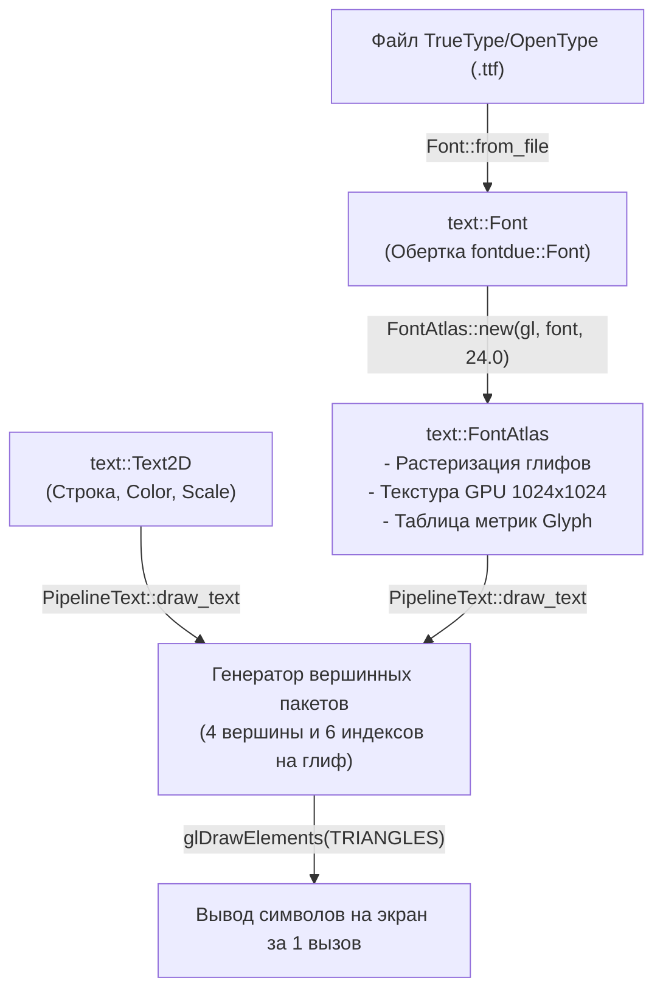

# Модуль `text` — Типографика, атлас глифов и рендеринг текста

Модуль `text` обеспечивает парсинг векторных шрифтов формата TTF/OTF, растеризацию глифов в текстурный атлас и пакетный рендеринг двумерного текста на базе OpenGL.

Исходный код: [`src/text/`](../../src/text/)

---

## 1. Конвейер рендеринга текста

Конвейер текста Oxide состоит из четырех последовательных этапов:



---

## 2. Загрузка шрифтов (`Font`)

Структура `Font` инкапсулирует парсер библиотеки `fontdue`:

```rust
// Загрузка из файла на диске
let font = Font::from_file("assets/fonts/DejaVuSans.ttf")?;

// Загрузка из байтового среза в ОЗУ
let font = Font::from_bytes(FONT_BYTES)?;

// Автоматический поиск системного или локального шрифта
let font = Font::default_font()?;
```

Метод `Font::default_font()` последовательно опрашивает пути:
1. `assets/fonts/DejaVuSans.ttf`
2. `C:\Windows\Fonts\DejaVuSans.ttf`
3. `/usr/share/fonts/truetype/dejavu/DejaVuSans.ttf`
4. `C:\Windows\Fonts\segoeui.ttf`
5. `/System/Library/Fonts/Helvetica.ttc`

---

## 3. Текстурный атлас глифов (`FontAtlas`)

При вызове `FontAtlas::new(gl, font, font_size)`:
1. Создается буфер изображения размером `1024x1024` пикселей (RGBA8).
2. Растеризуются следующие диапазоны символов:
   - **Печатные символы ASCII:** `32..=126` (пробел, цифры, латинские буквы, знаки препинания).
   - **Символы расширенной кириллицы:** `0x0400..=0x045F` (буквы А-Я, а-я, Ё, ё и региональные знаки).
   - **Специальные типографические символы:** `№`, `«`, `»`, `—`, `–`, `°`, `±`, `•`, `…`, `’`, `”`, `“`.
3. Глифы упаковываются полочным методом с сохранением отступов в 1 пиксель. Значения степени покрытия пикселя глифом сохраняются в альфа-канал текстуры.
4. Выделяется текстура `Texture2D` в видеопамяти GPU.
5. Для каждого символа сохраняется структура `Glyph`:
   ```rust
   pub struct Glyph {
       pub uv_min: Vec2,
       pub uv_max: Vec2,
       pub size: Vec2,
       pub offset: Vec2,
       pub advance_x: f32,
   }
   ```

### Измерение размеров текста:
```rust
let dimensions: Vec2 = atlas.measure_text("Вычисляемая строка текста\nВторая строка");
```

---

## 4. Описание текстового элемента (`Text2D`)

```rust
pub struct Text2D {
    pub content: String,
    pub color: Color,
    pub scale: f32,
}
```

Конструкторы:
```rust
let text = Text2D::new("Oxide Simulation Engine")
    .with_color(Color::rgb(0.2, 0.8, 1.0))
    .with_scale(1.2);
```

---

## 5. Конвейер отрисовки (`PipelineText`)

Шейдерная программа текста считывает значение альфа-канала из атласа и модулирует его цветом текста:
$$\mathbf{C}_{\text{out}} = (\mathbf{C}_{\text{color}}.\text{rgb}, \mathbf{C}_{\text{color}}.\text{a} \cdot \alpha_{\text{atlas}})$$

### Пакетный вывод:
Метод `draw_text` выполняет генерацию квадов для всех символов строки в локальные массивы вершин и индексов (4 вершины и 6 индексов на символ) и отправляет их в видеопамять одним вызовом:
```rust
pipeline_text.begin(ctx.gl, ctx.width as f32, ctx.height as f32);
pipeline_text.draw_text(
    ctx.gl,
    &atlas,
    "Пакетный вывод текста",
    Vec2::new(40.0, 50.0),
    Color::WHITE,
    1.0,
)?;
pipeline_text.end(ctx.gl);
```
